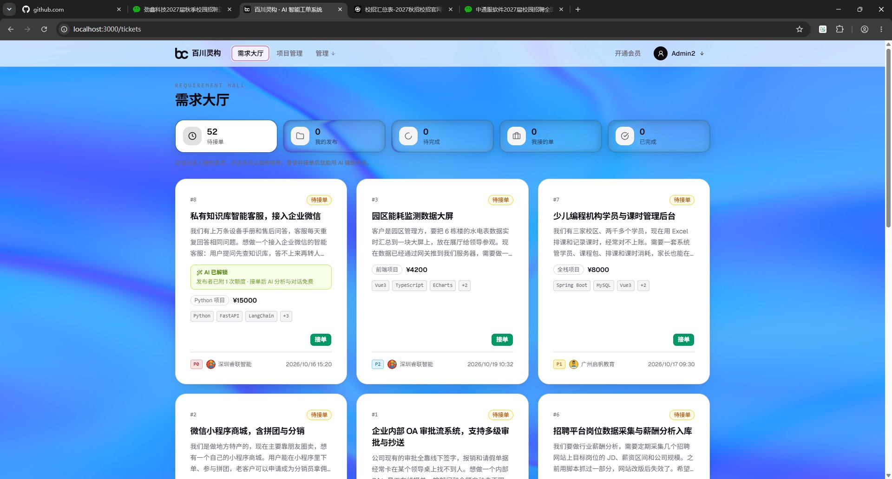
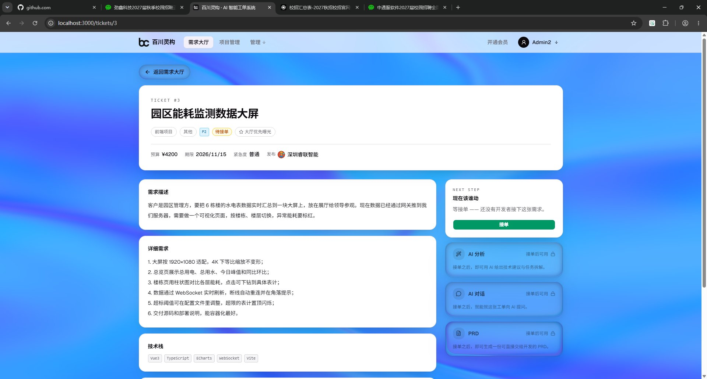
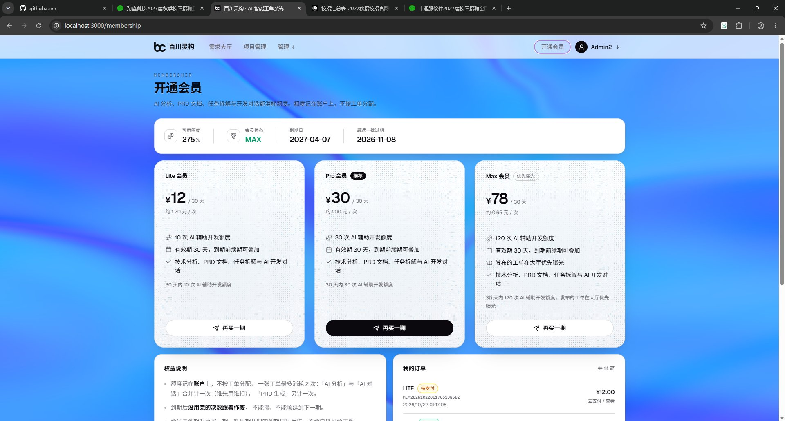

# 百川灵构 · AI 开发者接单平台

需求发布 → 接单开发 → 交付验收的完整闭环，AI 全程辅助（技术分析、PRD、任务拆解、开发对话），
外加会员额度与支付宝支付。

---

## 界面预览

以下截图取自本地开发环境（Chrome，1920×1032，演示数据来自 `db/seed/real_tickets.sql`），
原图存放在 `docs/screenshots/`，点击图片可查看大图。

### 需求大厅 · 一屏看清待办与工单

[](docs/screenshots/requirement-hall.jpg)

- 顶部五张统计卡按当前身份统计「待接单 / 我的发布 / 待完成 / 我接的单 / 已完成」。
- 卡片直接摊开决策信息：`#编号`、状态、优先级（P0–P2）、技术栈标签、预算、发布方与发布时间。
- 已消耗额度的工单会标注「AI 已解锁 · 接单后 AI 分析与对话免费」，接单前就能算清成本。

### 工单详情 · 需求与 AI 能力一页看完

[](docs/screenshots/ticket-detail.jpg)

- 左栏按「需求描述 → 详细需求 → 技术栈」排布，详细需求保留原始编号，验收时逐条对照。
- 右栏 `NEXT STEP` 卡片按工单状态给出下一步动作：未被接单时就是「接单」。
- AI 分析 / AI 对话 / PRD 三张能力卡在接单后解锁，未接单时明确置灰，不做无效点击。

### 开通会员 · 额度、套餐与订单

[](docs/screenshots/membership.jpg)

- 顶部状态条给出可用额度、会员状态、到期日与最近一批额度过期时间，先回答「还能用几次」。
- Lite / Pro / Max 三档同屏对比：价格、单次折算（约 1.20 / 1.00 / 0.65 元每次）、权益与有效期。
- 底部是权益说明与「我的订单」，待支付订单可续付或查看。

---

## 技术栈

| 层 | 使用 |
|---|---|
| 后端 | Spring Boot 3.3.0 · **Java 17**（见下方警告）· Spring Cloud Gateway 2023.0.1 |
| 数据库 | MySQL 8.x |
| 缓存 | Redis 7.x（双 Token、AI 对话记忆、AI 额度） |
| AI | LangChain4j 1.0.1-beta6 · DeepSeek（OpenAI 兼容协议） |
| 支付 | 支付宝沙箱（alipay-sdk-java） |
| 存储 | 阿里云 OSS（交付物压缩包、用户头像） |
| 前端 | React 19 + TypeScript + Vite 5 + Tailwind v4 + shadcn/base-ui + zustand |

> ⚠️ **必须用 JDK 17 构建。** JDK 23 起 `javac` 默认不再隐式运行注解处理器，
> 在 JDK 24 下 Lombok 不会生效，`mvn compile` 会出现大面积 `cannot find symbol`；
> 且增量编译可能显示"通过"而实际未运行 javac。

## 服务

| 模块 | 端口 | 职责 |
|---|---|---|
| `api-gateway` | 8080 | 唯一入口。JWT 校验，向下游注入 `X-User-Id` / `X-User-Role` |
| `user-service` | 8081 | 注册登录、双 Token、用户资料、头像（OSS）、接单者技能 |
| `ticket-service` | 8082 | 工单、私聊、AI（LangChain4j）、会员与订单、支付宝、项目 |
| `common` | — | 共享代码：Result / PageResult、全局异常、JWT、OSS、实体基类 |

**三个服务都只监听 `127.0.0.1`。** 下游服务不做鉴权，身份完全依赖网关注入的头。
如果绑到 `0.0.0.0`，同网段任何人都能直连 8081/8082 并伪造 `X-User-Id`，
鉴权就形同不存在。部署时保持回环 + 由网关反代。

## 快速开始

### 1. 基础设施

```bash
docker compose up -d          # MySQL 3306 + Redis 6379
```

### 2. 数据库

```bash
mysql -uroot -p < db/schema.sql
```

`db/schema.sql` 与全部 JPA 实体逐列一致（含 `updated_at` / `deleted_at` 与所有
`BIT(1)` 布尔列），可以直接用它建库。

可选种子：

```bash
mysql -uroot -p aiticket < db/sample-data.sql            # 小样本，各列齐全
mysql -uroot -p aiticket < db/seed/real_tickets.sql      # 50 张演示工单
```

> `db/migration.sql` 是补列脚本，**不可重复执行**（需要 `--force`），
> 仅用于给已存在的旧库补列。新建库不需要它。

### 3. 环境变量

都可不配 —— 服务照样启动，只有对应功能不可用。

```bash
# 数据库（三个服务共用，默认 aiticket/aiticket）
DB_URL=jdbc:mysql://localhost:3306/aiticket?useUnicode=true&characterEncoding=utf8&serverTimezone=Asia/Shanghai&useSSL=false&allowPublicKeyRetrieval=true
DB_USERNAME=aiticket
DB_PASSWORD=aiticket

# JWT。网关与 user-service 必须是同一个值
JWT_SECRET=<至少 32 字节的随机串>

# AI（DeepSeek）
DEEPSEEK_API_KEY=sk-...
DEEPSEEK_MODEL=deepseek-chat

# 阿里云 OSS（头像 / 交付物）
OSS_ENDPOINT=oss-cn-beijing.aliyuncs.com
OSS_BUCKET=...
OSS_ACCESS_KEY_ID=...
OSS_ACCESS_KEY_SECRET=...

# 支付宝沙箱（会员支付）
ALIPAY_APP_ID=...
ALIPAY_PRIVATE_KEY=...
ALIPAY_PUBLIC_KEY=...
ALIPAY_NOTIFY_URL=https://<你的公网隧道>/api/v1/membership/callback/alipay
ALIPAY_RETURN_URL=http://localhost:3000/membership/result
```

也可以放到各服务的 `src/main/resources/application-secret.yml`（已被 `.gitignore` 排除）。

### 4. 启动后端

```bash
mvn clean install -DskipTests

java -jar user-service/target/user-service-1.0.0-SNAPSHOT.jar      # 8081
java -jar ticket-service/target/ticket-service-1.0.0-SNAPSHOT.jar  # 8082
java -jar api-gateway/target/api-gateway-1.0.0-SNAPSHOT.jar        # 8080
```

开发时也可以：

```bash
mvn -pl user-service  spring-boot:run
mvn -pl ticket-service spring-boot:run
mvn -pl api-gateway   spring-boot:run
```

### 5. 启动前端

```bash
cd frontend
npm install
npm run dev          # http://localhost:3000，/api 已代理到 127.0.0.1:8080
```

## 前端工程约定

```bash
npm run type-check   # tsc --noEmit
npm run lint         # eslint（含 unused-imports）
npm run verify       # 上面两个一起跑
npm run build        # tsc + vite build
npm run audit:reach  # 从 main.tsx 做可达性分析，列出没人引用的文件
```

- 图标统一从 `src/components/icons.ts` 取，不直接 `import from 'lucide-react'`。
- 卡片与页头的样式常量定义在 `src/components/layout/PageShell.tsx`，页面里不重复写字面量。
- 所有 HTTP 请求走 `src/api/client.ts`（`request`）。它负责三件事：剥掉响应信封、
  40102 的刷新单飞、失败提示。自建 axios 实例会绕开这三件事。
- 页面走路由级懒加载（`router/index.tsx` 的 `page()`），第三方库在 `vite.config.ts`
  里切成 react / ui / form 三块，首屏 chunk 约 318 kB（gzip 105 kB）。新增页面请沿用懒加载。
- 页面标题用 `PageHeader`（等宽大写 eyebrow + 中文标题）。全站背景是高饱和的虹彩蓝，
  直接压在背景上的次要文字用 `text-foreground/60` 并加一层淡白色 text-shadow，否则浅蓝区域会糊。

## 功能完成度

| 模块 | 状态 |
|---|---|
| 注册 / 登录 / 双 Token 自动续期 | ✅ |
| 需求大厅（筛选、分页、身份卡片、滚动位置恢复） | ✅ |
| 工单详情（AI 分析 / PRD / 对话、交付与验收、私聊入口） | ✅ |
| 发布 / 编辑需求 | ✅ |
| 工单私聊 | ✅ |
| 会员套餐 / 支付宝下单 / 支付结果页（轮询 + 切回重查） | ✅ |
| 个人主页（头像、昵称、额度、订单、接单者技能） | ✅ |
| 用户管理 / 统计分析（管理员） | ✅ |
| 项目管理（项目 / 模块 / 任务 / 里程碑 / 讨论） | ⚠️ 后端 32 个接口可用，前端三个页面未实现（入口显示「即将上线」） |
| 知识库 | ❌ 未实现。`knowledge_base` 表当前没有任何代码读写，导航中不提供入口 |

## 目录

```
ai-ticket-system/
├── api-gateway/     # 8080 唯一入口，JWT → X-User-Id
├── user-service/    # 8081 账号、资料、头像、技能
├── ticket-service/  # 8082 工单、AI、会员、支付、项目
├── common/          # 共享：Result / 异常 / JWT / OSS / BaseEntity
├── frontend/        # React 19 + Vite
├── db/
│   ├── schema.sql   # 建库脚本
│   ├── migration.sql# 补列脚本（不可重复执行）
│   └── seed/        # 演示数据
├── docs/            # screenshots/ 存 README 界面截图（1920×1032）
├── docker-compose.yml
└── DESIGN.md        # 视觉规范
```

## 运维要点

- 网关与 user-service 的 `jwt.secret` 必须一致，否则表现为"登录成功但之后每个接口都 401"。
- 支付宝回调需要公网可达（开发期用 natapp 之类隧道，免费版域名每次重启都会变）。
  `notify-url` 改完要重启 ticket-service，且旧的待支付订单不要再用
  （它带着下单那一刻的 notify-url）。
- 支付结果页会轮询查单；`PENDING` 超过 15 分钟时后端会主动向支付宝查一次兜底，
  所以回调丢失也能自愈。
- 会员额度「发布即消耗、不退还」；一张工单最多消耗 2 次（分析+对话算一次，PRD 另算）。
